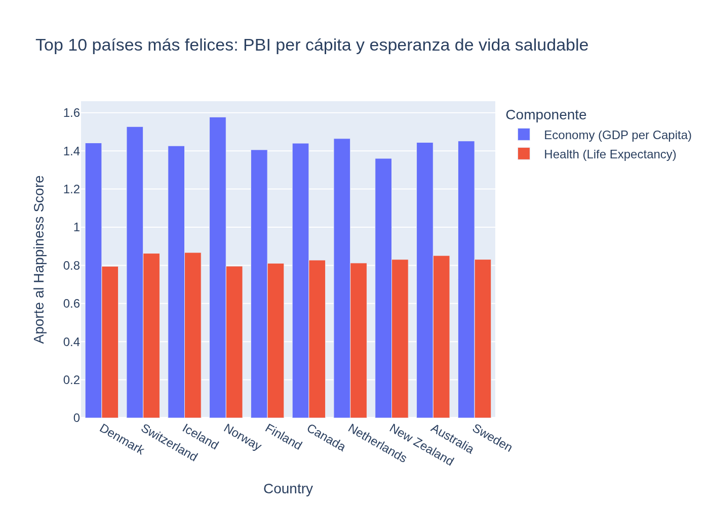
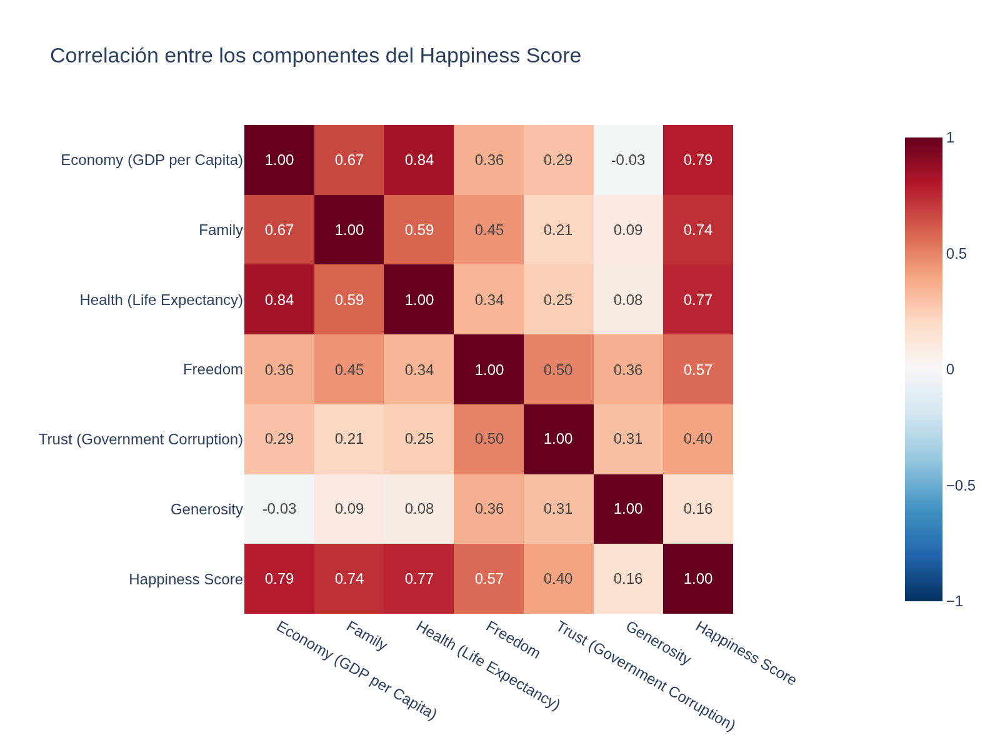
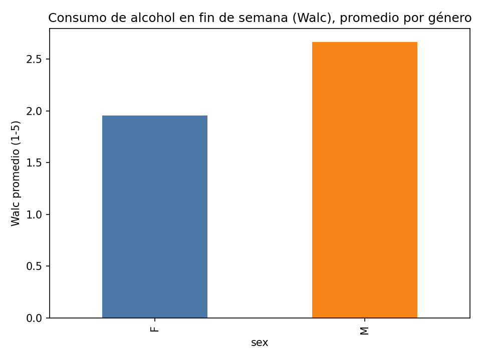
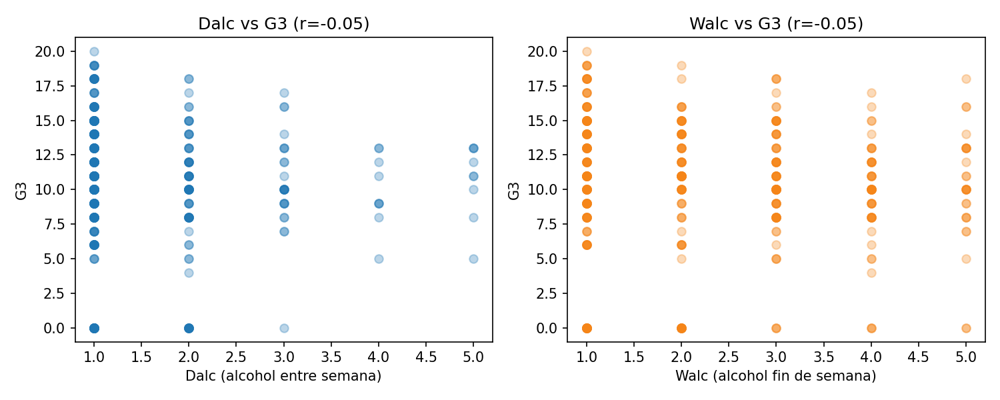

# IA generativa para análisis de datos

Dos ejercicios de **IA generativa aplicada a análisis de datos**, hechos en el curso *Generative AI: Enhance your Data Analytics Career* (parte del IBM Data Analyst Professional Certificate), con el código escrito y verificado directamente a partir de lo trabajado en el curso.

**Herramientas:** Python (pandas, matplotlib, Plotly) · LangChain · IBM watsonx.ai (Llama 4 Maverick)

## 1. Dashboard World Happiness Report 2016 (Plotly)

Reporte para un escenario de consultoría: ¿qué características económicas y regionales se asocian con un Happiness Score más alto? 157 países, World Happiness Report 2016.



**Pipeline:** `src/01_limpieza.py` (carga, verificación de tipos, imputación de nulos columna por columna) → `src/02_visualizaciones.py` (5 figuras Plotly) → `src/03_dashboard.py` (las junta en `docs/dashboard.html`).

**Hallazgos principales** (detalle en [docs/hallazgos.md](docs/hallazgos.md)):
- El PBI per cápita (r=0.79), la esperanza de vida saludable (r=0.77) y el apoyo familiar (r=0.74) son los componentes más asociados al score; la generosidad es el que menos (r=0.16).
- Brecha de 3.19 puntos entre la región más feliz (Australia/NZ, 7.32) y la menos feliz (Sub-Saharan Africa, 4.14) — mayor que la diferencia entre el país #1 y el #20 del ranking.
- Perú: puesto 64/157, score 5.74, por debajo del promedio de su región (Latin America and Caribbean, 6.10).

**Decisión documentada:** el prompt original del proyecto guiado pedía un *pie chart* de Happiness Score por región — se reemplazó por barras del promedio, porque un pie de esta variable suma los scores y sobre-representa a las regiones con más países (ver nota en hallazgos.md).



Dashboard interactivo completo (las 5 figuras, incluido el mapa): [docs/dashboard.html](docs/dashboard.html) — ábrelo en el navegador.

## 2. Agente de datos en lenguaje natural (LangChain + watsonx)

Un agente que conecta un LLM (**Llama 4 Maverick** en **IBM watsonx.ai**) a un DataFrame de pandas con `create_pandas_dataframe_agent` de LangChain (patrón ReAct): se le habla en lenguaje natural, el agente escribe y ejecuta código pandas/matplotlib, y el código que usó queda visible (`intermediate_steps`).

Dataset: `student-mat.csv` (UCI, Student Alcohol Consumption, 395 alumnos).

- **`src/04_agente_langchain_watsonx.py`** — el agente real. Necesita credenciales de IBM watsonx.ai (no incluidas en este repo) para ejecutarse en vivo.
- **`src/05_reproduccion_verificada.py`** — reproduce con código pandas/matplotlib directo los mismos gráficos que el agente genera, para poder verificar y correr el proyecto sin necesitar esas credenciales.

**Bug real resuelto al construir el agente** (documentado en el código): `handle_parsing_errors=True` pasado directamente a `create_pandas_dataframe_agent(...)` no llega al `AgentExecutor` en `langchain-experimental==0.0.57` — hay que pasarlo via `agent_executor_kwargs={"handle_parsing_errors": True}`. Con `verbose=True` se confirmó la causa: el modelo escribía una frase antes de `Thought:`, fuera del formato que el parser esperaba.




## Cómo reproducirlo

```bash
pip install -r requirements.txt
python src/01_limpieza.py
python src/02_visualizaciones.py
python src/03_dashboard.py
python src/05_reproduccion_verificada.py   # no necesita credenciales
# python src/04_agente_langchain_watsonx.py  # necesita WATSONX_URL / WATSONX_APIKEY / WATSONX_PROJECT_ID
```

## Estructura
```
data/             datasets (2016.csv de World Happiness Report, student-mat.csv de UCI)
src/               pipeline de limpieza, visualizaciones, dashboard y agente
docs/               hallazgos.md + dashboard.html
img/               gráficos exportados
```

## Fuentes
- World Happiness Report 2016 (Kaggle, CC0), vía el proyecto guiado del curso de IBM.
- UCI Machine Learning Repository, Student Alcohol Consumption (`student-mat.csv`).

## Otros proyectos
Parte de mi portafolio de análisis de datos: [github.com/asramirez-svg](https://github.com/asramirez-svg)

**Autor:** Augusto Set Ramírez Ames — analista de datos, IBM Data Analyst Professional Certificate. [LinkedIn](https://linkedin.com/in/AugustoRamirezA)
